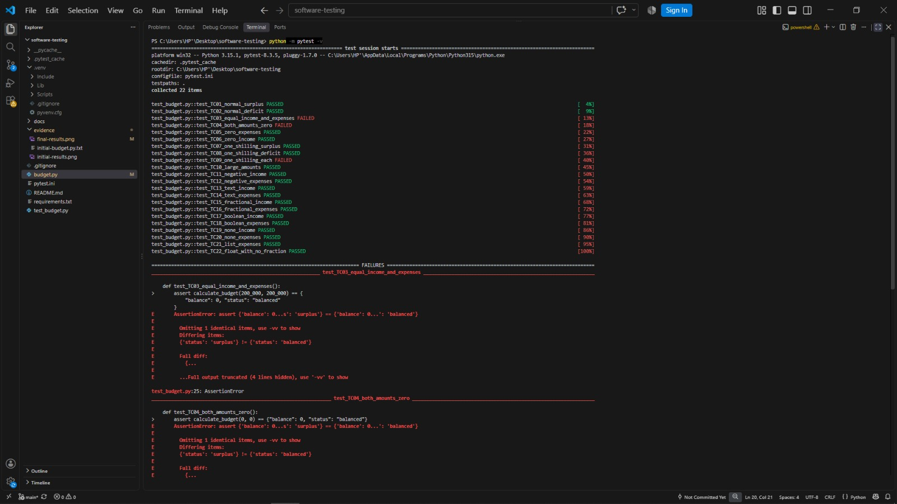
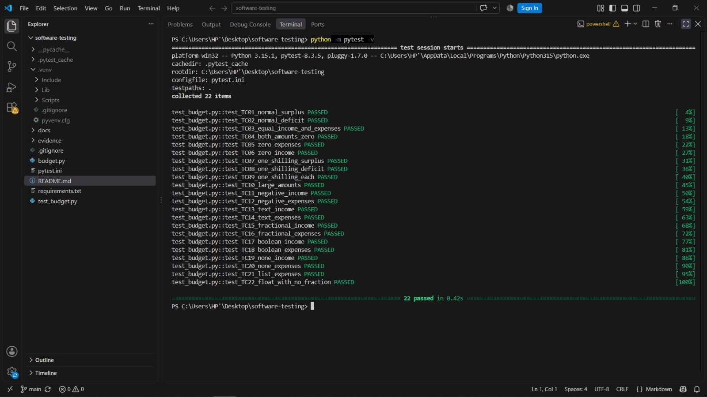

# Personal Budget Balance Report

**Student:** Ainemukama Alfred
**Language and framework:** Python and pytest

## 1. Test Case Design

I prepared [22 test cases](test-cases.md), each with an ID, input, expected result, actual result, and status. Each case corresponds to one automated test.

| Cases | Coverage |
| --- | --- |
| TC01-TC03 | Normal inputs and the surplus, deficit, and balanced outputs |
| TC04-TC09 | Zero inputs and balances immediately above, at, and below zero |
| TC10 | Large integer amounts |
| TC11-TC12 | Negative income and expenses |
| TC13-TC22 | Invalid types, including text, floats, booleans, None, and a list |

## 2. Function Implementation

I implemented `calculate_budget(income, expenses)` in Python.

| Item | Rule |
| --- | --- |
| Inputs | Total income and total expenses |
| Validation | Both inputs must be non-negative integers. Zero is valid. |
| Processing | Validate income, validate expenses, then calculate `balance = income - expenses` |
| Positive balance | Return the balance with status `surplus` |
| Zero balance | Return zero with status `balanced` |
| Negative balance | Return the negative balance with status `deficit` |
| Wrong input type | Raise `TypeError` identifying the input |
| Negative input | Raise `ValueError` identifying the input |
| Output format | A dictionary containing `balance` and `status` |

For example, income of 500,000 UGX and expenses of 350,000 UGX return `{'balance': 150000, 'status': 'surplus'}`. Expenses greater than income are valid and produce a deficit.

### Assumptions

- Income and expenses are totals for the same period and use whole Uganda shillings (UGX).
- Expenses are supplied as one total rather than a list of purchases.
- Floats, including `100.0`, are rejected. Text values are not converted to numbers.
- Booleans are rejected even though Python treats them as a type of integer.
- Both arguments are required. If both are invalid, income is checked first.
- No maximum amount is specified; calculations use Python integers.

The source code is in [budget.py](../budget.py).

## 3. Automated Unit Testing

I wrote 22 separate tests using pytest in [test_budget.py](../test_budget.py). Tests for valid inputs compare the complete returned dictionary with the expected balance and status. Tests for invalid inputs use `pytest.raises` to check the exception type and message.

An invalid-input test passes when the expected error is raised. The three valid output statuses are tested separately, and the boundary cases include balances of -1, 0, and 1.

## 4. Test Execution and Results

| Version | Tests executed | Passed | Failed |
| --- | ---: | ---: | ---: |
| Initial version with a deliberately introduced zero-balance defect | 22 | 19 | 3 |
| Corrected version | 22 | 22 | 0 |

The existing screenshots show execution on Windows with Python 3.15.1 and pytest 8.3.5. A verification run on 12 November 2026 using Python 3.12.14 and pytest 8.3.5 on Linux also passed all 22 tests.

### Defect and Correction

To demonstrate defect detection, the initial version used `if balance >= 0`. This incorrectly classified a zero balance as `surplus`, so TC03, TC04, and TC09 failed.

| Item | Result |
| --- | --- |
| Defect ID | D01 |
| Example input | Income `200000`, expenses `200000` |
| Expected result | `{'balance': 0, 'status': 'balanced'}` |
| Initial actual result | `{'balance': 0, 'status': 'surplus'}` |
| Correction demonstrated | Replace `if balance >= 0` with `if balance > 0` |
| Retest result | TC03, TC04, and TC09 passed; all 22 tests passed |

The initial version is preserved in [initial-budget.py.txt](../evidence/initial-budget.py.txt). Re-running the complete test suite after the correction checked that the surplus, deficit, and validation cases still passed. No additional defects were found by these tests.

### Test Result Screenshots

Initial results:

Final results:

## 5. Final Result

The function calculates the remaining budget and returns the correct status for the tested valid inputs. Invalid inputs raise the expected errors. All 22 automated tests passed. The submitted work includes the source code, unit-test code, test-case table, screenshots, and this report.
